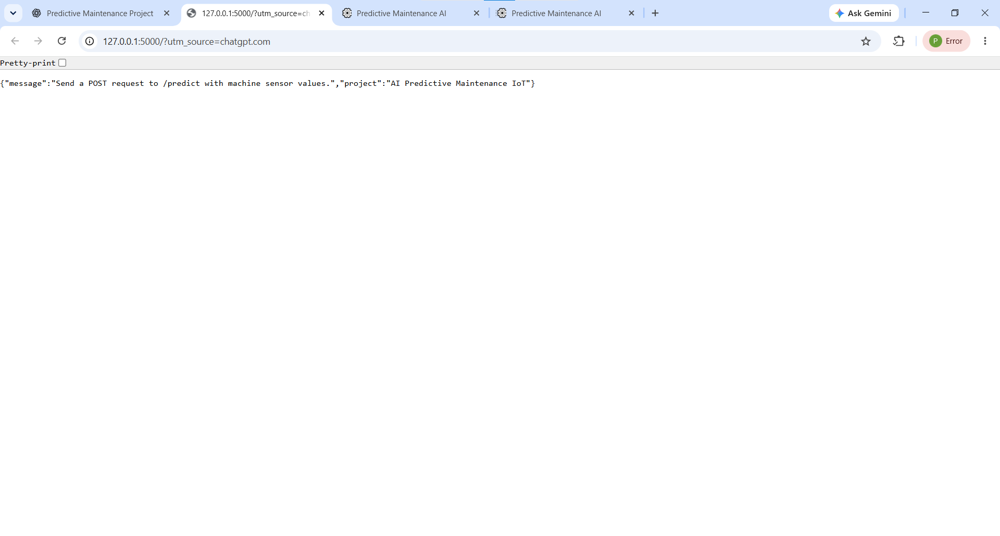
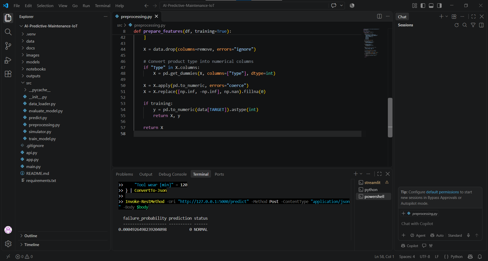

# AI-Powered Predictive Maintenance System for IoT Devices

An educational machine-learning project that estimates machine-failure risk from industrial operating-condition readings using the UCI AI4I 2020 Predictive Maintenance Dataset.
## 🚀 Live Demo

Try the deployed application here:

[AI Predictive Maintenance Dashboard](https://ai-predictive-maintenance-iot-yqumipkphfabnwkgvrgcxz.streamlit.app/)

## Features
- Public dataset download and preprocessing
- Feature engineering (temperature difference and mechanical power)
- Random Forest classification
- Evaluation metrics, confusion matrix and feature importance
- Simulated sensor-reading predictions
- Streamlit dashboard and Flask prediction API

## Project structure
```text
AI-Predictive-Maintenance-IoT/
├── data/raw/                 # Dataset downloaded on first run
├── data/processed/           # Reserved for processed datasets
├── notebooks/                # Exploratory analysis notebook
├── src/                      # Data, model, evaluation and prediction modules
├── models/                   # Trained model (created after training)
├── outputs/                  # Charts and prediction CSV (created after training)
├── images/                   # Add your project screenshots here
├── docs/                     # Documentation
├── app.py
├── api.py
├── main.py
└── requirements.txt
```

## Setup (Windows PowerShell)
```powershell
cd path\to\AI-Predictive-Maintenance-IoT
py -3.12 -m venv .venv
.\.venv\Scripts\Activate.ps1
python -m pip install --upgrade pip
pip install -r requirements.txt
python main.py
```
If PowerShell blocks activation, run `Set-ExecutionPolicy -Scope Process -ExecutionPolicy Bypass` in that terminal, then activate again.

The first run downloads the dataset. An internet connection is required for that first download. The trained model and evaluation outputs are generated by `python main.py`.

## Launch dashboard
```powershell
streamlit run app.py
```

## Launch API
Open another terminal after training:
```powershell
python api.py
```
POST JSON to `http://127.0.0.1:5000/predict`, for example:
```json
{
  "Type": "M",
  "Air temperature [K]": 300.0,
  "Process temperature [K]": 310.0,
  "Rotational speed [rpm]": 1500,
  "Torque [Nm]": 40.0,
  "Tool wear [min]": 120
}
```

## Dataset and attribution
AI4I 2020 Predictive Maintenance Dataset, UCI Machine Learning Repository: https://archive.ics.uci.edu/dataset/601/ai4i+2020+predictive+maintenance+dataset

## Important limitations
This is a portfolio/learning prototype. It predicts the dataset's machine-failure label from sensor-like readings; it is not a verified real-time industrial warning system, remaining-useful-life model, or safety controller. Never use it to automatically stop real equipment.

## Results
## Screenshots

### Dashboard


### API Response


### Normal Prediction


### High Risk Prediction

